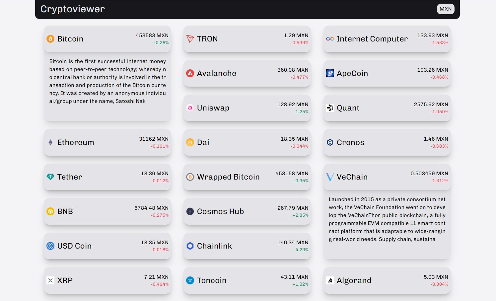

# 🪙 Arselt Cryptoviewer

### A react.js with redux app for tracking crypto prices

⚛️ This project was bootstrapped with [Create React App](https://github.com/facebook/create-react-app), [Redux](https://es.redux.js.org/) and [TailwindCSS](https://tailwindcss.com/)

## Deploy

### [🚀 Deploy: arselt-cryptoviewer.netlify.app](https://arselt-cryptoviewer.netlify.app/)

## Setup

- ### Download the repository

- ### Install dependencies with `pnpm install`
- ### run `pnpm dev`

- ### Open [http://localhost:3000](http://localhost:3000) to view the local development mode in your browser.
